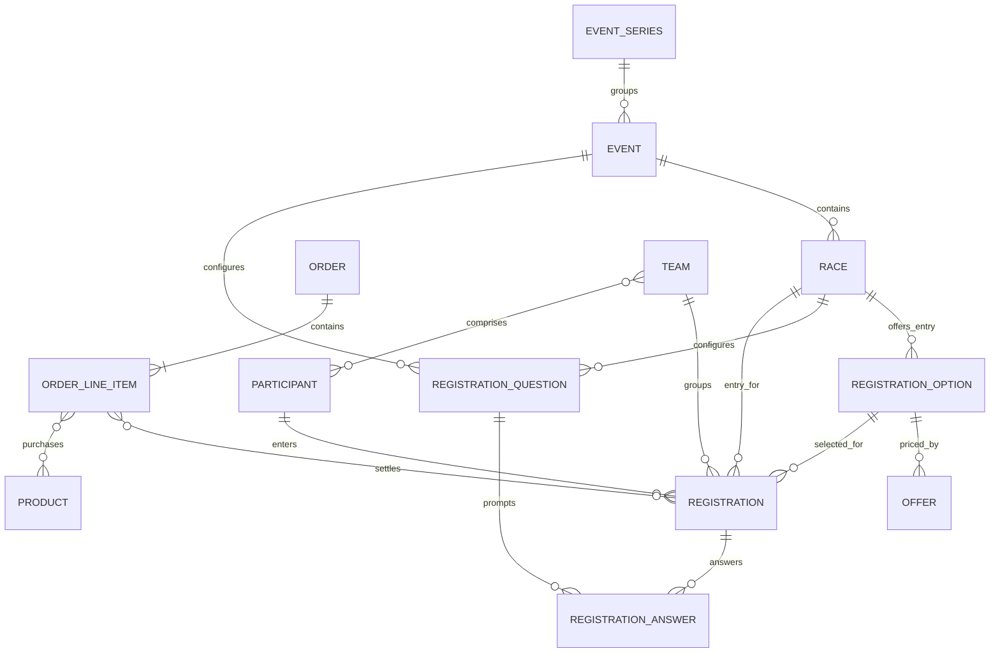

# OmniEvent endurance event and registration architecture

**Status: Phase 1 proposal — not approved for implementation.** This architecture is a language-independent exchange-model recommendation based on the evidence in [platform-models.md](research/platform-models.md) and [crosswalk.md](crosswalk.md). It does not assert that any platform implements the proposed fields.

## Current repository architecture (verified)

- `structure/Event.php`, `Race.php` and `Course.php` are the source classes used by `generate/all.php` to write `dist/{event,race,course}/schema.json`. They set JSON Schema Draft-07, `id`, properties, formats, required fields, enums and `$ref`s. The published schema references point to raw files on the `main` branch.
- Current Event requires `name`, `startDate` and `eventStatus`; start/end dates use JSON Schema `format: date`. Its optional `races` array references the Race schema. Race requires `name`; `startTime` is `date-time`; `participation` defaults to `solo` and allows `solo`, `team`, `relay`. Course has optional `topology` only.
- The parallel `models/` tree is a PHP Schema.org model layer using `spatie/schema-org`: `Event` extends `SportsEvent`, and stores `Race` objects through Schema.org `subEvent`; `Race` also extends `SportsEvent`. `EventRegistration` extends `EventReservation`, using `reservationFor` and `attendee`; `Participant` extends `Person`; question/answer classes extend `Question`/`Answer`; `RegistrationOrder` extends `Order`.
- These model classes and the JSON Schemas are **not one source of truth**. `generate/all.php` generates the published schemas from `structure/`; `bin/generate_schemas.php` is a separate legacy-style model-based generator. `composer.json` explicitly requires `spatie/schema-org`; `swaggest/json-schema-maker` is a dev dependency, while the source schema classes import `Swaggest\JsonSchema` symbols without an explicit `swaggest/json-schema` direct requirement in this manifest.
- Tests primarily compare serialized PHP model output to fixtures. The current examples/fixtures are not a platform mapping suite; the repository has no full registration/order JSON Schema or canonical JSON-LD projection schema.
- The WordPress plugin separately emits JSON-LD `SportsEvent` blocks and uses `subEvent` for linked races. Its post metadata is not an adapter for the exchange schemas.
- The only tracked GitHub Actions workflow found deploys the WordPress plugin on tags; no CI workflow for schema generation or tests was found. Existing docs contain earlier design assertions that should be treated as history, not as an approved future architecture.

Relevant files: [`composer.json`](../composer.json), [`structure/`](../structure/), [`generate/all.php`](../generate/all.php), [`bin/generate_schemas.php`](../bin/generate_schemas.php), [`models/`](../models/), [`dist/`](../dist/), [`tests/`](../tests/), [`wordpress-plugin/`](../wordpress-plugin/), [workflow](../.github/workflows/wordpress-plugin-deploy.yml).

### Compatibility implications

The emitted Event JSON already uses `races`, while Schema.org serialization uses `subEvent`. Consumers may depend on either output. The current Event status is a bare enum token in canonical schema JSON but the Schema.org model serializes a full Schema.org URL. Event dates are date-only in the JSON Schema even though PHP docs call them `DateTime`; Race has a date-time `startTime`. A new contract must not silently reinterpret existing documents or claim round-trip fidelity where only one representation exists.

Keep the current schemas and PHP model behavior available as the v1 compatibility baseline. Proposed expanded schemas should be versioned separately, with explicit migration and projection tests before any change to existing generated files or model serialization.

## Canonical domain proposal

The smallest useful separation is:

```text
EventSeries 1 ──* Event 1 ──* Race
                              └──* RegistrationOption 1 ──* Offer
Event/Race ──* RegistrationQuestion / Waiver
Participant 1 ──* Registration *──1 Race
Registration *──1 RegistrationOption
Order 1 ──* OrderLineItem ──0..* Registration / Product
Team 1 ──* Registration / Participant
```

`Offer` is a price/availability proposal, not a race. `RegistrationOption` is the eligibility/entry choice (individual, corporate, charity, elite, relay/team variant) and may have one or more time-bounded Offers. A Race may have multiple options and offers. `Product`/`ProductGroup` represent purchasable extras and variants, not the race itself. `Registration` records a submitted entry; `Participant` is reusable identity data; `Order` is the commercial transaction. One order may contain multiple line items/registrations and multiple participants.



### Entity recommendations

| Entity | Responsibility and primary semantics |
|---|---|
| `EventSeries` | Optional recurring or named series. Use Schema.org `EventSeries`; not required for a one-off event. |
| `Event` | One edition/occurrence with name, description, date range, status, attendance mode, venue, organizer, sport, branding, languages, public URL, races and optional series link. |
| `Race` | A competition within the event: sport/discipline, distance, start/waves, course, segments, participation mode, capacity, eligibility, categories, cutoffs and identity. A race is not a registration product. |
| `Course` | Route/course data: topology, distance, elevation, route asset links (for example GPX) and route metadata. schema.org has no exact endurance-course equivalent; retain a clearly namespaced OmniEvent extension in projection. |
| `RegistrationOption` | Entry class/policy such as individual, relay, charity or elite. Holds team requirements and eligibility. It is distinct from both Race and price. |
| `Offer` / `PriceTier` | A time-, quantity- or eligibility-limited price for an option, using currency, availability and explicit fee components. Schema.org `Offer` applies to the commercial offer; a tier with extra eligibility rules remains an OmniEvent object. |
| `Product` / `ProductGroup` | Optional merchandise/add-on and its variants. Use Schema.org Product types only for actual purchasable goods/services. |
| `RegistrationQuestion`, `Waiver` | Event/race/option-scoped configuration. Answers reference stable question IDs. Waiver version and acceptance are registration records, not a `Question` answer. |
| `Participant` | Person identity data, separated from event-specific registration. Avoid globally matching people based only on name, email or birth date. |
| `Registration` | A submitted/held/cancelled entry for a participant or group in a race and selected option; includes event-specific answers, consents and status. Schema.org `EventReservation` is a useful projection, not a complete registration schema. |
| `Team` | Team identity, category/type, roster cardinality and member registrations. Schema.org `SportsTeam` can describe the sports team, but does not express all registration and roster rules. |
| `Order` / `OrderLineItem` | Checkout/transaction boundary. A line item records purchased offer/product, quantity, exact amounts and the registrations it settles. Schema.org `Order`/`OrderItem` are projection targets; private payment credentials are never included. |

### Edition, event and race boundaries

Do **not** introduce a mandatory `EventEdition` wrapper. A particular dated occurrence should be an `Event`; use optional `EventSeries` to link recurring editions through Schema.org `superEvent`/`subEvent` relationships. An organizer may call an annual edition an event, race, or event in its platform UI; source identifiers and the separately modeled Race preserve that distinction.

Retain canonical `races[]` for the endurance-specific child collection and backward recognition. Project each Race to a Schema.org `SportsEvent` node placed in the parent Event's `subEvent`. This preserves explicit race semantics in canonical exchange while using Schema.org's more general hierarchy in JSON-LD. Never label arbitrary registration options as sub-events.

### References, IDs, extension namespace

- Every canonical entity has an `id` that is an absolute URI and stable within the OmniEvent producer's namespace. A URI is preferred to a platform-local integer. IDs identify entities, not people across unrelated systems.
- Store source identifiers as `externalIdentifiers[]` records `{ "system": "https://…", "value": "…" }`; the `system` identifies the platform/tenant namespace, while `value` preserves its opaque original type/value as text. Keep distinct IDs for Event, Race, option, registration, participant, order and product.
- Canonical payloads may embed complete child objects for portable event snapshots. Where normalized exchange or graph cycles require references, use `{ "ref": "absolute-uri" }`; do not overload JSON Schema `$ref` in instance data and do not use `@id` in canonical JSON.
- Use `extensions` as an object keyed by stable namespace URI, containing only that publisher's opaque extension data. Preserve unknown extension keys on import/export. Do not use generic underscore prefixes or promote a platform field to the core model without crosswalk evidence.
- Keep sync state (source, remote version/ETag, import timestamp, cursor, observed/updated times, ownership and capabilities) in adapter metadata outside event facts. It is not event content and must not leak into public JSON-LD.

## Canonical JSON and JSON Schema

The canonical exchange document is ordinary JSON validated by the published OmniEvent JSON Schema. It is **not JSON-LD** and has no required `@context`, `@type`, or `@id`. Use separate versioned schema URIs and identify format version with a schema reference or explicit `schemaVersion`; finalize one convention in the schema ADR before implementation. Keep the current Draft-07 schemas addressable for existing consumers. Draft-07 remains a proposed first expanded-schema target because it matches the repository and broad validator availability; add a future-schema evaluation gate rather than mixing drafts in one contract.

Basic shape (proposed fields; not yet implemented):

```json
{
  "id": "https://events.example.org/2027/city-road-races",
  "name": "City Road Races",
  "startDate": "2027-05-16",
  "timeZone": "Europe/Bucharest",
  "eventStatus": "EventScheduled",
  "races": [
    {
      "id": "https://events.example.org/2027/city-road-races/half",
      "name": "Half Marathon",
      "distance": { "value": 21.0975, "unitCode": "KMT" },
      "participation": "solo"
    }
  ]
}
```

Keep required core fields minimal. The v1 schema requires `name`, date-only `startDate` and `eventStatus`; a v2 profile should retain these for v1 migration compatibility unless maintainers approve a separate compatibility profile. Additional context (location, time zone, discipline, registration) is optional. A schema-valid event may still lack the physical address required by Google for its Event rich-result experience; do not impose Google indexing requirements on the exchange standard.

## Dates, time zones, money, measures and language

- Use ISO 8601/RFC 3339 forms: calendar date `YYYY-MM-DD` when only a date is known; for an instant use a full timestamp with explicit `Z` or numeric offset. Do not fabricate midnight or a time zone for date-only source data.
- Preserve a separate IANA time zone identifier (for example `Europe/Bucharest`) for event-local schedules and daylight-saving interpretation. An offset alone is not a durable local schedule; the IANA zone alone is not an instant.
- Represent money as an exact decimal **string** plus ISO 4217 currency (for example `{"value":"125.00","currency":"RON"}`); never use binary floating point for financial arithmetic. Retain separately disclosed base price, tax, processing fee, donation and total. No currency conversion occurs in an adapter.
- Represent physical quantities with a numeric value and standardized unit code (UN/CEFACT Recommendation 20 where a suitable code exists); preserve original source units if a conversion cannot be proven exact. Avoid a bare distance number.
- Use BCP 47 tags for languages. Keep the default `name`/`description` as plain strings for simple JSON and Schema.org compatibility, and optional `translations` as BCP 47 keyed localized values. JSON-LD projection emits language-tagged values (`@value`/`@language`) or a locale-selected value; a canonical translation map is not itself a Schema.org property.

## Eligibility, gender and privacy

Keep eligibility rules separate from personal identity and from marketing gender fields. Age rules should include comparison operator/bounds, inclusive/exclusive semantics, reference date/rule, and any organizer category. Preserve source labels and original values if a partner requires a sex/gender division; do not silently reinterpret them as `Person.gender`. Do not infer that Schema.org `eligibleQuantity` can encode age/category rules.

Separate public event/configuration documents from private registration records. Do not publish participants, emergency contacts, answers, waivers, email/telephone, birth dates or order details in public event JSON-LD. No payment card/bank credentials or health records are in scope. An implementation needs access control and data minimization beyond schema validation.

## Schema.org and JSON-LD projection

Projection is a deliberate graph transformation, not `@context`/`@type` added to the canonical object:

| Canonical entity/property | Schema.org projection |
|---|---|
| Event | `SportsEvent` (subtype of `Event`); names, description, dates, status, URL, image, organizer, location, language and sport map where their value semantics match. |
| EventSeries and parent/child | `EventSeries`, `superEvent` and `subEvent`; event `races[]` becomes `subEvent[]` containing Race `SportsEvent` nodes. |
| Race distance/course/segments/waves/eligibility | No complete endurance-race vocabulary. Project appropriate quantities as `QuantitativeValue`; preserve otherwise through a registered OmniEvent namespace. Do not use unrelated `Course` (educational course) as a race course. |
| RegistrationOption and Offer | Emit `Offer` for an actual registration sale with `price`, `priceCurrency`, availability, validity and URL as known. `RegistrationOption` remains a distinct OmniEvent resource/extension; do not collapse relay/eligibility rules into `Offer`. `AggregateOffer` is only a summary of actual offers, not a replacement for their details. |
| Add-on | `Product`/`ProductGroup` and `Offer` for a real purchasable item/variant. |
| Registration and participant | `EventReservation` with `reservationFor` pointing to the Race, `attendee` as `Person`, and reservation status/identifier where semantics match. Custom `Registration` properties remain namespaced. |
| Order and line item | `Order`/`OrderItem` with an `orderedItem` and monetary information when consistent with actual transaction semantics. Keep sensitive payment data private. |
| Question/answer | `Question`/`Answer` and `parentItem` where the answer actually answers that question; extension data retains requiredness, conditional logic, consent, validation and version semantics. |
| External identifier | `identifier` as text or a structured `PropertyValue`; retain the source namespace. |

Example: canonical event + races, projected to JSON-LD (illustrative and intentionally public-only):

```json
{
  "@context": {
    "schema": "https://schema.org/",
    "omni": "https://sportic.org/ns/omnievent#"
  },
  "@id": "https://events.example.org/2027/city-road-races",
  "@type": "schema:SportsEvent",
  "schema:name": "City Road Races",
  "schema:startDate": "2027-05-16",
  "schema:eventStatus": "https://schema.org/EventScheduled",
  "schema:location": {
    "@type": "schema:Place",
    "schema:name": "Bucharest"
  },
  "omni:timeZone": "Europe/Bucharest",
  "schema:subEvent": [
    {
      "@id": "https://events.example.org/2027/city-road-races/half",
      "@type": "schema:SportsEvent",
      "schema:name": "Half Marathon",
      "schema:sport": "Road running",
      "omni:distanceValue": 21.0975,
      "omni:distanceUnitCode": "KMT"
    }
  ]
}
```

The JSON-LD serializer must define one stable extension context, project enum URIs to Schema.org URLs (unlike current bare canonical status tokens), emit consistent `@id`s, preserve language tags, and avoid serializing private fields. Validate with a JSON-LD 1.1 processor and verify that every emitted non-schema term is defined. Google rich-result validation is a separate, optional output check; schema.org-valid markup does not guarantee search eligibility.

In the illustrative projection, custom distance data should be emitted with explicitly defined OmniEvent terms (for example, `omni:distanceValue` and `omni:distanceUnitCode`) rather than arbitrary object keys. A JSON-LD processor silently ignores unexpanded keys; a projection test must catch that kind of loss.

## Model validation scenarios

All examples below are design tests, not committed fixtures or implementation payloads. Shared notation shows the intended separations and must be expanded into complete schema-validated documents in Phase 2.

### Road running: many distances, independent options and tiers

```json
{
  "id": "https://events.example.org/city/2027",
  "name": "City Marathon Weekend",
  "startDate": "2027-05-16",
  "timeZone": "Europe/Bucharest",
  "eventStatus": "EventScheduled",
  "races": [
    { "id": "https://events.example.org/city/2027/marathon", "name": "Marathon", "distance": { "value": 42.195, "unitCode": "KMT" }, "participation": "solo" },
    { "id": "https://events.example.org/city/2027/half", "name": "Half Marathon", "distance": { "value": 21.0975, "unitCode": "KMT" }, "participation": "solo" },
    { "id": "https://events.example.org/city/2027/10k", "name": "10K", "distance": { "value": 10, "unitCode": "KMT" }, "participation": "solo" },
    { "id": "https://events.example.org/city/2027/5k", "name": "5K", "distance": { "value": 5, "unitCode": "KMT" }, "participation": "solo" },
    { "id": "https://events.example.org/city/2027/kids", "name": "Children's Race", "distance": { "value": 1, "unitCode": "KMT" }, "participation": "solo", "eligibility": { "ageRules": [{ "minAge": 6, "maxAge": 12, "ageCalculationDate": "2027-12-31" }] } }
  ],
  "registrationOptions": [
    { "id": "https://events.example.org/city/2027/half/individual", "race": { "ref": "https://events.example.org/city/2027/half" }, "name": "Individual", "offers": [{ "id": "https://events.example.org/city/2027/half/early", "name": "Early bird", "price": { "value": "35.00", "currency": "EUR" }, "validThrough": "2027-01-31T23:59:59+02:00" }, { "id": "https://events.example.org/city/2027/half/regular", "name": "Regular", "price": { "value": "45.00", "currency": "EUR" }, "validFrom": "2027-02-01T00:00:00+02:00" }] },
    { "id": "https://events.example.org/city/2027/half/corporate", "race": { "ref": "https://events.example.org/city/2027/half" }, "name": "Corporate Team", "teamType": "corporate", "teamSize": { "min": 4, "max": 8 }, "offers": [{ "id": "https://events.example.org/city/2027/half/corporate/regular", "price": { "value": "40.00", "currency": "EUR" } }] }
  ]
}
```

The example demonstrates that two entry options can target one Race, and that time-varying prices are Offers rather than additional races.

### Trail ultra: route, cutoffs, eligibility and waitlist

```json
{
  "id": "https://events.example.org/mountain/2027",
  "name": "Mountain Ultra",
  "startDate": "2027-09-04",
  "timeZone": "Europe/Bucharest",
  "eventStatus": "EventScheduled",
  "races": [{
    "id": "https://events.example.org/mountain/2027/100k",
    "name": "100K Ultra",
    "sport": "Trail running",
    "distance": { "value": 100, "unitCode": "KMT" },
    "course": {
      "id": "https://events.example.org/mountain/2027/100k/course",
      "elevationGain": { "value": 6500, "unitCode": "MTR" },
      "route": { "mediaType": "application/gpx+xml", "url": "https://routes.example.org/100k.gpx" }
    },
    "cutoffs": [{ "checkpoint": "Pass", "distance": { "value": 50, "unitCode": "KMT" }, "timeLimit": "PT12H" }],
    "eligibility": { "ageRules": [{ "minAge": 18, "ageCalculationDate": "2027-09-04" }], "prerequisites": ["documented prior ultra finish"] },
    "capacity": 400,
    "waitlistPolicy": { "enabled": true }
  }]
}
```

Cutoff/checkpoint and prerequisite structures are OmniEvent extensions; do not map them to unrelated Schema.org properties.

### Triathlon: separate distances, segments, relay and licence

```json
{
  "id": "https://events.example.org/lake-tri/2027",
  "name": "Lake Triathlon",
  "startDate": "2027-06-20",
  "timeZone": "Europe/Bucharest",
  "eventStatus": "EventScheduled",
  "races": [
    { "id": "https://events.example.org/lake-tri/2027/sprint", "name": "Sprint", "sport": "Triathlon", "segments": [{ "discipline": "swimming", "distance": { "value": 0.75, "unitCode": "KMT" } }, { "discipline": "cycling", "distance": { "value": 20, "unitCode": "KMT" } }, { "discipline": "running", "distance": { "value": 5, "unitCode": "KMT" } }] },
    { "id": "https://events.example.org/lake-tri/2027/olympic", "name": "Olympic", "sport": "Triathlon", "segments": [{ "discipline": "swimming", "distance": { "value": 1.5, "unitCode": "KMT" } }, { "discipline": "cycling", "distance": { "value": 40, "unitCode": "KMT" } }, { "discipline": "running", "distance": { "value": 10, "unitCode": "KMT" } }] },
    { "id": "https://events.example.org/lake-tri/2027/middle", "name": "Middle distance", "sport": "Triathlon", "segments": [{ "discipline": "swimming", "distance": { "value": 1.9, "unitCode": "KMT" } }, { "discipline": "cycling", "distance": { "value": 90, "unitCode": "KMT" } }, { "discipline": "running", "distance": { "value": 21.1, "unitCode": "KMT" } }] }
  ],
  "registrationOptions": [
    { "id": "https://events.example.org/lake-tri/2027/olympic/individual", "race": { "ref": "https://events.example.org/lake-tri/2027/olympic" }, "name": "Individual", "eligibility": { "requirements": [{ "type": "federationLicence", "required": true }] } },
    { "id": "https://events.example.org/lake-tri/2027/olympic/relay", "race": { "ref": "https://events.example.org/lake-tri/2027/olympic" }, "name": "Three-person relay", "participation": "relay", "teamSize": { "min": 3, "max": 3 } }
  ]
}
```

### Virtual race: flexible participation window

```json
{
  "id": "https://events.example.org/virtual/2027",
  "name": "Run Anywhere 10K",
  "startDate": "2027-04-01",
  "endDate": "2027-04-30",
  "eventAttendanceMode": "OnlineEventAttendanceMode",
  "eventStatus": "EventScheduled",
  "races": [{ "id": "https://events.example.org/virtual/2027/10k", "name": "10K", "distance": { "value": 10, "unitCode": "KMT" }, "participationWindow": { "startDate": "2027-04-01", "endDate": "2027-04-30" }, "completionEvidence": ["participant-reported"] }]
}
```

Use Schema.org `VirtualLocation` only when an actual online location/resource exists; asynchronous flexible participation is not a live virtual venue.

### Complex registration: two participants, two entries, one order

```json
{
  "participants": [
    { "id": "https://people.example.org/p/1001", "name": { "givenName": "Ana", "familyName": "Ionescu" } },
    { "id": "https://people.example.org/p/1002", "name": { "givenName": "Mihai", "familyName": "Ionescu" } }
  ],
  "registrations": [
    { "id": "https://registrations.example.org/r/501", "participant": { "ref": "https://people.example.org/p/1001" }, "race": { "ref": "https://events.example.org/city/2027/5k" }, "registrationOption": { "ref": "https://events.example.org/city/2027/5k/individual" }, "answers": [{ "question": { "ref": "https://events.example.org/city/2027/questions/shirt" }, "value": "S" }] },
    { "id": "https://registrations.example.org/r/502", "participant": { "ref": "https://people.example.org/p/1002" }, "race": { "ref": "https://events.example.org/city/2027/5k" }, "registrationOption": { "ref": "https://events.example.org/city/2027/5k/individual" }, "answers": [{ "question": { "ref": "https://events.example.org/city/2027/questions/shirt" }, "value": "M" }] }
  ],
  "orders": [{
    "id": "https://orders.example.org/o/900",
    "currency": "EUR",
    "discounts": [{ "code": "FAMILY10", "amount": { "value": "10.00", "currency": "EUR" } }],
    "lineItems": [
      { "id": "https://orders.example.org/o/900/li/1", "registration": { "ref": "https://registrations.example.org/r/501" }, "amount": { "value": "20.00", "currency": "EUR" } },
      { "id": "https://orders.example.org/o/900/li/2", "registration": { "ref": "https://registrations.example.org/r/502" }, "amount": { "value": "20.00", "currency": "EUR" } },
      { "id": "https://orders.example.org/o/900/li/3", "product": { "ref": "https://events.example.org/city/2027/products/medal-frame" }, "quantity": 1, "amount": { "value": "12.00", "currency": "EUR" } }
    ],
    "total": { "value": "42.00", "currency": "EUR" }
  }]
}
```

This design requires references across independently represented entities, supports multiple entries in one order, and keeps Participant identity separate from event-specific answers and transaction details.

### Romanian and English content

```json
{
  "name": "Maratonul Orașului",
  "description": "Alergare pentru toată comunitatea.",
  "translations": {
    "ro-RO": { "name": "Maratonul Orașului", "description": "Alergare pentru toată comunitatea." },
    "en": { "name": "City Marathon", "description": "A community road race." }
  }
}
```

`name` and `description` remain simple default-locale strings. The translations are canonical OmniEvent data and require a projection policy; they are not invented Schema.org fields.

## Standards and primary references

- [Schema.org Event](https://schema.org/Event), [SportsEvent](https://schema.org/SportsEvent), [EventSeries](https://schema.org/EventSeries), [EventReservation](https://schema.org/EventReservation), [Offer](https://schema.org/Offer), [AggregateOffer](https://schema.org/AggregateOffer), [Place](https://schema.org/Place), [PostalAddress](https://schema.org/PostalAddress), [GeoCoordinates](https://schema.org/GeoCoordinates), [Organization](https://schema.org/Organization), [Person](https://schema.org/Person), [Product](https://schema.org/Product), [ProductGroup](https://schema.org/ProductGroup), [Order](https://schema.org/Order), [OrderItem](https://schema.org/OrderItem), [PropertyValue](https://schema.org/PropertyValue), [QuantitativeValue](https://schema.org/QuantitativeValue), [PriceSpecification](https://schema.org/PriceSpecification), [MonetaryAmount](https://schema.org/MonetaryAmount).
- [JSON-LD 1.1 W3C Recommendation](https://www.w3.org/TR/json-ld11/); [JSON Schema Draft-07](https://json-schema.org/draft-07/schema); [JSON Schema 2020-12](https://json-schema.org/draft/2020-12/json-schema-core.html).
- [Google Event structured data](https://developers.google.com/search/docs/appearance/structured-data/event). Search eligibility and valid Schema.org JSON-LD are different validation goals.
- [ISO 8601 date and time](https://www.iso.org/iso-8601-date-and-time-format.html); [IANA Time Zone Database](https://www.iana.org/time-zones); [ISO 4217 currency codes](https://www.iso.org/iso-4217-currency-codes.html); [UN/CEFACT Recommendation 20](https://unece.org/trade/uncefact/uncl); [BCP 47 language tags (RFC 5646)](https://www.rfc-editor.org/rfc/rfc5646).

## Adapter contract

```text
Platform API ──> read/normalize adapter ──> canonical OmniEvent JSON
Platform API <── write/serialize adapter <── canonical OmniEvent JSON
```

An adapter must:

1. **Declare capability and evidence:** platform/API version, supported read/create/update/delete per resource and field, permissions, source documentation, and verification date.
2. **Preserve identity:** retain source-scoped identifiers for every resource; never use display names as IDs. Repeated import upserts by platform namespace + source ID, preserves canonical IDs, records source revision/ETag and avoids duplicating children.
3. **Map enums explicitly:** maintain versioned source-to-canonical tables; preserve unknown source values verbatim under that platform namespace with `unmapped` fidelity. Never silently coerce an unknown value to a default.
4. **Normalize dates without invention:** preserve date-only values as dates; normalize timestamps with explicit offsets; add an IANA time zone only when source data establishes one. Flag ambiguous local timestamps.
5. **Preserve money and units:** exact decimal-string amount and ISO 4217 currency; separate prices/fees/taxes; no FX conversion. Convert units only with known source and target units, retaining original values and documenting rounding.
6. **Report information loss:** return field-level mapping results (`direct`, `transformed-lossless`, `lossy`, `extension-only`, `unsupported`, `unverified`) with source path, target path, reason, and unconverted payload where permitted. A rejected write or omitted field is an explicit error/diagnostic, not success.
7. **Protect unknown data:** round-trip unknown extension keys and source-specific values without allowing them to collide with core properties.
8. **Separate sync state:** keep cursors, import times, endpoint, source version, ownership and conflicts in adapter metadata, not in public event content.
9. **Handle updates as reconciliation:** compare source IDs/version and normalized field hashes, distinguish source-owned and user-edited values, use API pagination/incremental markers only as documented, and surface deletion/conflict decisions instead of silently overwriting.

Representative fixtures should be sanitized real source API responses paired with canonical expected output and reverse payloads. Each must record source doc/version, permissions, known unsupported fields and expected fidelity. No full platform adapter is in Phase 1.

## Proposed implementation sequence after approval

1. Agree on open questions and canonical field/reference/version rules; confirm platform API evidence and sanitized samples.
2. Publish v2 entity schemas and migration profile alongside v1; keep Draft-07 and `structure/` + `generate/all.php` unless a tested technical blocker appears.
3. Add schema generation/consistency tests and language-neutral fixtures for simple events, races, options, registration records and orders.
4. Add typed PHP structures/models aligned to the accepted canonical contract, without making them the only normative definition.
5. Build JSON-LD projector and tests for JSON-LD validity, Schema.org mappings, extensions, IDs, locales and public-data privacy.
6. Add per-platform mapping fixtures and capability profiles, then implement one adapter at a time only where source evidence supports it.
7. Document versioning, migration, compatibility and deprecation before changing current schemas or PHP serialization.
